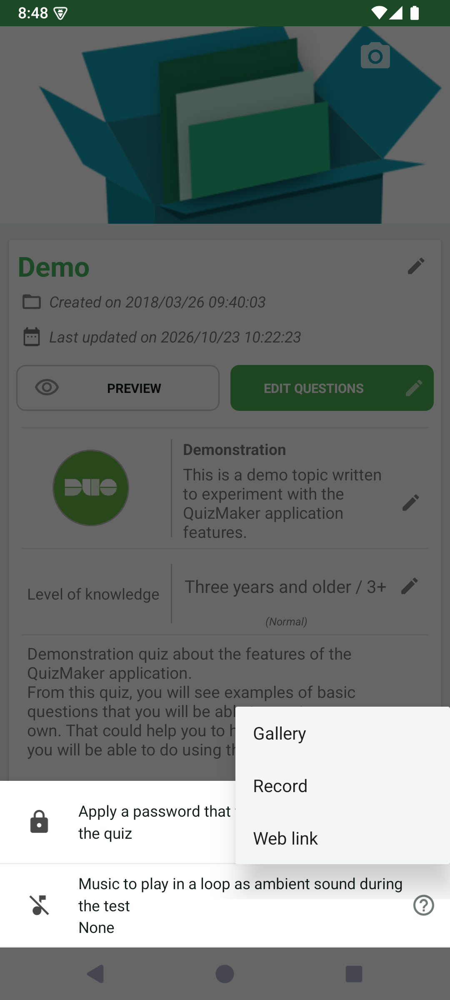

# Add background music to a quiz

A quiz can include an ambient soundtrack that plays in a loop during a test. This soundtrack belongs to the whole quiz, unlike audio attached to one question, answer, or correction comment.

## How to access

Open a quiz → **Edit information** → toolbar overflow menu → **More options** → **Music to play in a loop as ambient sound during the test**.

## Choose the sound

1. Open the ambient-sound row.
2. Choose **Gallery** for an existing audio file, **Record** for a recording, or **Web link** for an audio resource available online.
3. Complete the selected import or recording flow and grant the requested file or microphone access when necessary.
4. Check the selected sound, close the options, and save the quiz.

When audio is already attached, reopen the row to inspect the available playback, replacement, or removal actions. Keep your soundtrack quiet enough for spoken questions and answer audio to remain understandable.

## Check playback

Launch the quiz to test the result. In **Preferences → Quiz & player**, the **Background sound playback** setting controls automatic playback when a quiz provides a soundtrack.

Adding a soundtrack can require premium access. Use an audio file you are allowed to include when sharing the quiz. This option adds an existing or recorded sound; it does not compose music for you.

- [Edit quiz information](../edit-information.md)
- [Attach audio to a question or comment](../../editor/media-and-comments.md)
- [Quiz & player settings](../../settings/player/README.md)

---

© QmakerTech — Last updated: 2026-11-09
