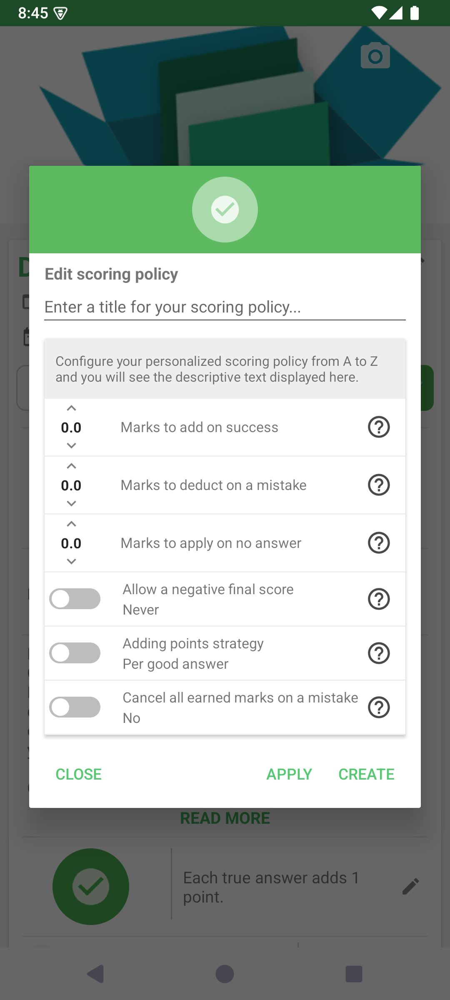

# Créer un barème personnalisé

Un barème définit comment un quiz attribue des points, applique des pénalités et traite les questions sans réponse. Adaptez-le à votre objectif : un entraînement et une évaluation chronométrée peuvent nécessiter des règles différentes.

## Comment y accéder

Ouvrez un quiz → **Modifier les informations** → ligne du barème → **Ajouter une entrée**.

## Définir les règles

1. Donnez un titre reconnaissable au barème.
2. Définissez les points de réussite, la pénalité d'erreur et la valeur d'une absence de réponse. Les décimales sont acceptées.
3. Examinez les stratégies supplémentaires sous les champs numériques.
4. Lisez la description produite pour vérifier qu'elle correspond à votre intention.

| Réglage | Choix à effectuer |
|---|---|
| Points à ajouter en cas de réussite | Nombre de points gagnés pour une réponse correcte. |
| Points à déduire en cas d'erreur | Nombre de points perdus pour une réponse incorrecte. |
| Points à appliquer sans réponse | Contribution d'une question laissée sans réponse. |
| Autoriser un score final négatif | Possibilité de descendre sous zéro selon les règles choisies. |
| Stratégie d'ajout des points | Attribution par bonne réponse ou pour la question dans son ensemble. |
| Annuler les points acquis en cas d'erreur | Annulation éventuelle des points gagnés dans la question dès qu'une erreur survient. |

Utilisez **Appliquer** pour appliquer la définition au quiz. Utilisez **Créer** pour enregistrer un barème nommé dans la liste disponible. Si le sélecteur reste ouvert, choisissez le barème voulu et validez. Vérifiez sa description dans les informations du quiz, puis enregistrez les modifications.

## Vérifier les conséquences

Faites un court essai avec une bonne réponse, une mauvaise réponse et une question laissée vide. Testez aussi une question à plusieurs bonnes réponses : attribuer des points par réponse et récompenser une question entièrement correcte peut produire des totaux différents.

Un barème personnalisé peut demander un accès premium. Le choix du barème modifie la notation ; il ne réécrit ni les questions ni leurs réponses de référence.

- [Modifier les informations du quiz](../edit-information-fr.md)

---

© QmakerTech — Dernière mise à jour : 2026-11-09
