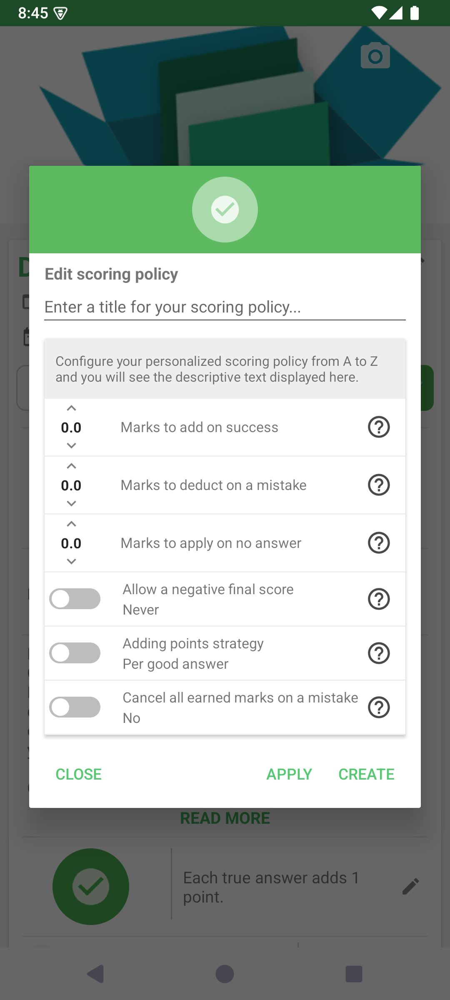

# Create a custom scoring policy

A scoring policy defines how a quiz awards points, applies penalties, and treats unanswered questions. Choose it to match the learning goal: encouraging practice and assessing a timed test may call for different rules.

## How to access

Open a quiz → **Edit information** → scoring-policy row → **Add a new entry**.

## Define the rules

1. Give the policy a recognizable title.
2. Set the points for success, the penalty for a mistake, and the value for no answer. Decimal values are supported.
3. Review the additional strategies below the numeric fields.
4. Read the generated description to check that it matches your intention.

| Setting | What to decide |
|---|---|
| Marks to add on success | How many points a correct response earns. |
| Marks to deduct on a mistake | How many points a wrong response loses. |
| Marks to apply on no answer | How an unanswered question contributes to the score. |
| Allow a negative final score | Whether the selected rules can produce a score below zero. |
| Adding points strategy | Whether points depend on each correct answer or the question as a whole. |
| Cancel all earned marks on a mistake | Whether a mistake cancels the points earned within that question. |

Use **Apply** to apply the current definition to the quiz. Use **Create** to save a named policy in the available list. If the selector remains open, choose the intended policy and validate it. Check the scoring description on the quiz information screen, then save your changes.

## Test the consequences

Run a short test with a correct answer, a wrong answer, and an unanswered question. Also test a question with multiple correct answers: rewarding each answer and rewarding a fully correct question can produce different totals.

Custom scoring may require premium access. Selecting a scoring policy changes scoring behavior; it does not rewrite your questions or the reference answers.

- [Edit quiz information](../edit-information.md)

---

© QmakerTech — Last updated: 2026-11-09
