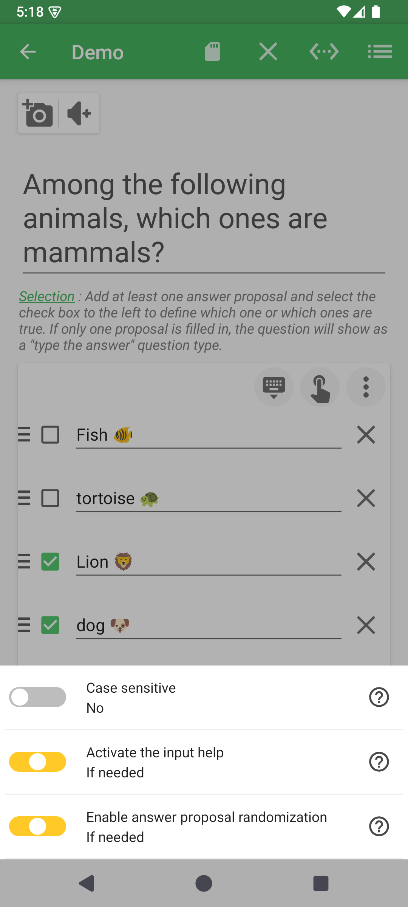
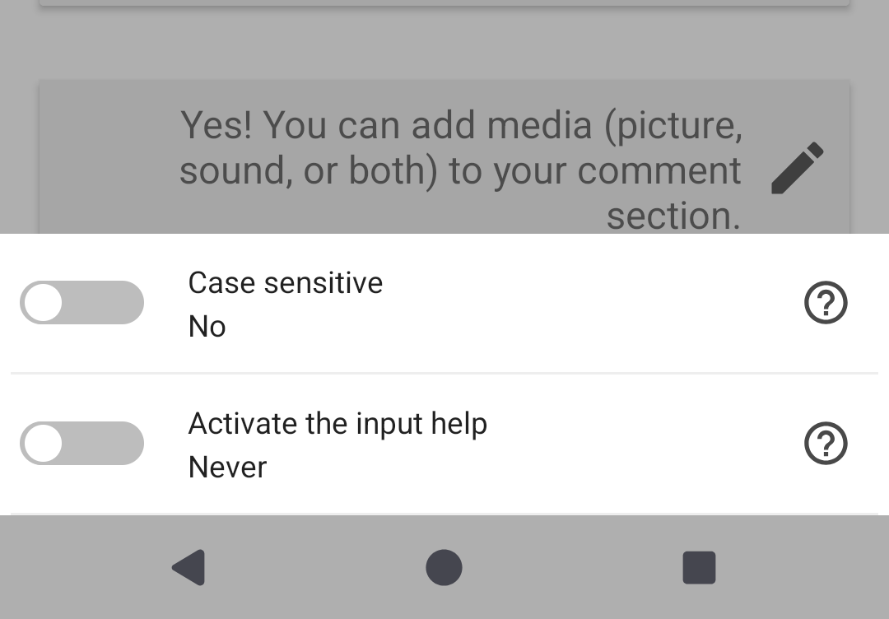
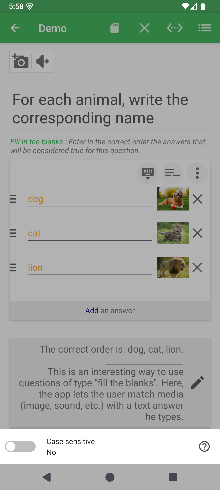
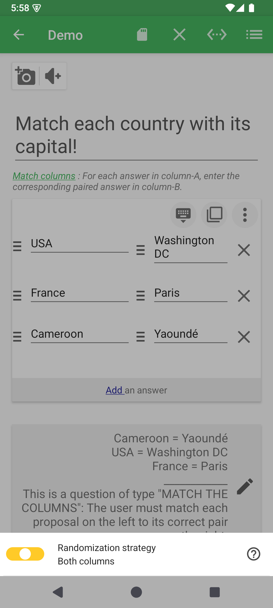
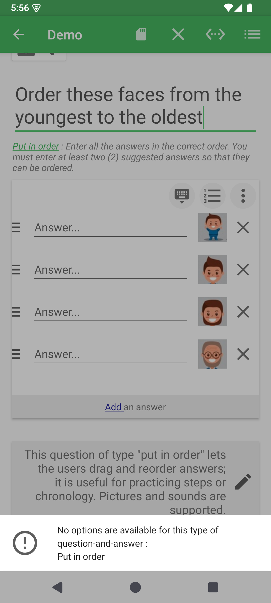
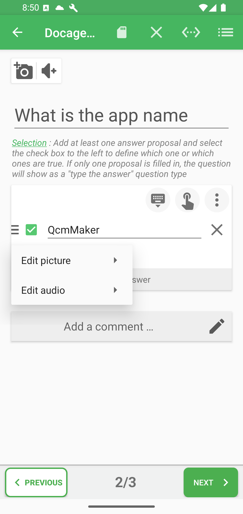

# Question and answer options

The answer card contains two different option areas. The vertical three-dot button at the top right changes settings for the whole question. The control at the left of an answer row changes only that answer.

## Question-level options

Tap the vertical three-dot button at the top right of the answer card. QcmMaker shows only the settings that make sense for the active question type.

| Visual family | Question types | Options shown |
|---|---|---|
| Selection | Selection variants | Case sensitivity, input help, answer randomization, and optional display limits |
| Text answers | Type answer, Enumeration | Case sensitivity and input help |
| Blank filling | Fill in the blanks | Case sensitivity |
| Matching | Match columns | Randomize the left column, right column, or both |
| No available options | Put in order, Jumbled words | An explanatory message instead of settings |

### Selection options

Randomizing answers reduces position-based memorization. Display limits are useful when a question contains a larger answer pool than should appear in one session.

### Text-answer and enumeration options

These types focus on how typed input is compared and whether input assistance is available; selection-only randomization controls are not shown.

### Fill-in-the-blanks options

### Match-column options

The two sides can be shuffled independently. The stored pairs remain the correction reference even when their display order changes.

### Types without question options

Put in order and Jumbled words use the order authored in the answer section as their reference, so this sheet does not expose extra settings.

## Case sensitivity and input help

In the question-level options, enable **Case sensitivity** when uppercase and lowercase must count as different in typed answers. Leave it disabled when, for example, `Paris` and `paris` should be accepted as equivalent. Test with the same question type the learner will use.

Use **Input help** to choose the assistance offered while entering an answer, where supported. Check the result in the player: this setting changes the answering experience, not the reference answer stored in the editor. Save the quiz after adjusting either option.

## Options for one answer row

Tap the options area at the left of an answer. The visible menu depends on both the question type and whether that answer already has media or a clue.

| Question types | Row options |
|---|---|
| Selection, Match columns, Put in order | Picture and audio actions |
| Type answer, Enumeration | Text evaluation: exact equality, contains, or pattern match |
| Fill in the blanks | Picture, audio, text evaluation, and clue actions |
| Jumbled words | Keep word fragments textual; proposition media may be rejected during validation |

An existing image adds view, crop, or remove actions. Existing audio adds listen or remove actions. For a blank with a clue, the direct add action becomes edit and delete choices.

## Add or edit an answer clue

For **Fill in the blanks**, open the target answer row's options and choose the clue action. Enter a hint that helps the learner find the missing word without giving it away, then confirm and save. Reopen the same menu to edit or remove a clue. A clue guides the learner; the accepted answer stays in the answer field.

**Previous:** [Edit questions](README.md)

**Next:** [Add media and correction comments](media-and-comments.md)
