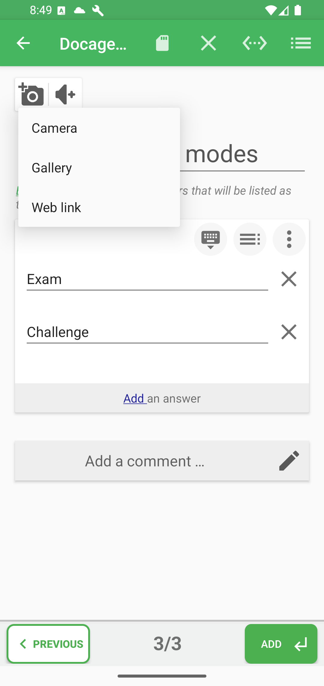
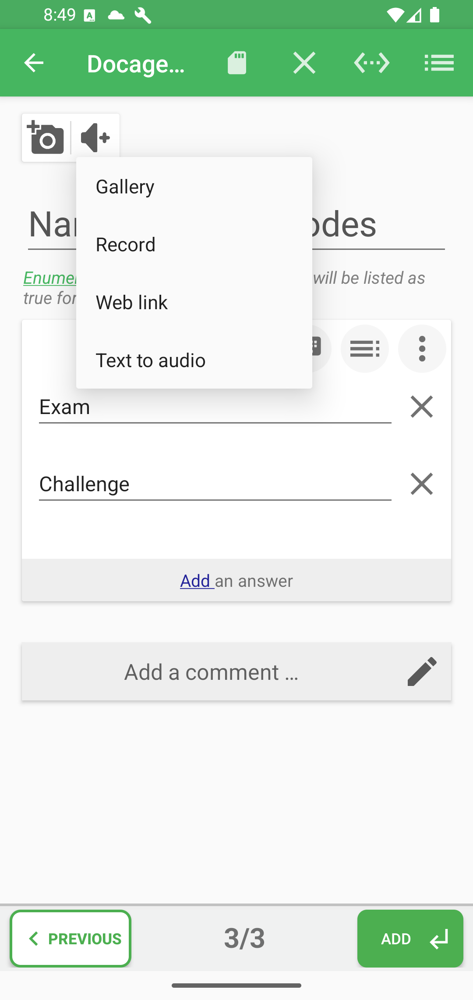
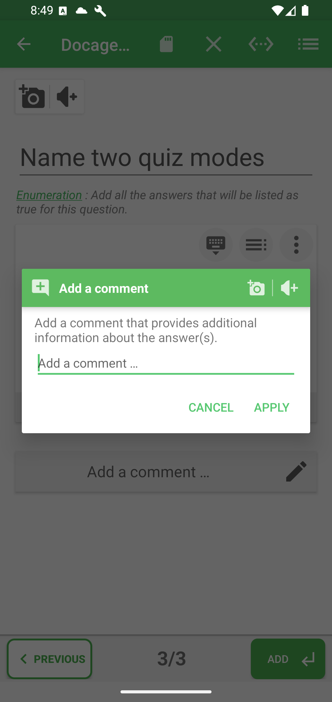

# Images, sons et commentaires de correction

Un média peut appartenir à la question, à une réponse particulière lorsque le type l'autorise, ou au commentaire de correction. Ajoutez-le au niveau où il aide réellement à comprendre.

## Ajouter une image à la question

Touchez l'appareil photo au-dessus de l'énoncé. Vous pouvez prendre une photo, choisir une image sur l'appareil, utiliser un lien web ou retirer l'image. Des actions de disposition et de recadrage peuvent apparaître lorsqu'une image existe.

## Ajouter un son à la question

Touchez le bouton audio pour choisir un fichier, enregistrer un son, utiliser un lien web ou créer un audio depuis un texte. Le lecteur permet ensuite de l'écouter et de rouvrir ses actions.

## Ajouter un média à une réponse

Ouvrez les options à gauche de la ligne, puis choisissez le sous-menu image ou audio. Ces commandes sont masquées pour les types qui attendent uniquement du texte saisi.

Dans une association de colonnes, chaque cellule possède son propre média, même si deux cellules forment une seule paire.

## Transformer du texte en audio

Ouvrez le menu audio de la question, d'une réponse compatible ou d'un commentaire, puis choisissez la synthèse vocale. Saisissez le texte à prononcer, vérifiez les réglages de voix ou de langue disponibles et écoutez le résultat avant de le joindre. Validez le dialogue audio, puis enregistrez le quiz. Cela produit une ressource audio sans remplacer la question ou la réponse écrite.

## Modifier la disposition d'une image

Joignez d'abord une image, puis rouvrez ses actions et choisissez la disposition lorsqu'elle est disponible. Sélectionnez le placement ou l'affichage proposé pour cette image, validez et prévisualisez la question pour contrôler la place de l'image par rapport au texte. Les choix dépendent de l'emplacement de l'image et du type de question. Le recadrage modifie la zone visible de l'image ; la disposition change sa présentation.

## Ajouter une explication de correction

Touchez **Add a comment / Ajouter un commentaire** ou le crayon. Le commentaire peut associer :

- un texte explicatif ;
- une image ;
- un son.

Utilisez-le pour expliquer la bonne réponse, clarifier une erreur fréquente ou indiquer ce qu'il faut réviser. Touchez **Apply / Appliquer**, puis enregistrez le quiz depuis l'éditeur principal.

Le dialogue de commentaire permet aussi de **mettre le texte en forme** : sélectionnez des mots dans son champ textuel et choisissez **Format** pour utiliser le gras, l'italique, le soulignement, les couleurs ou le surlignage. Ces outils sont également disponibles directement dans les champs des propositions de réponse. Consultez [la mise en forme des propositions et des commentaires](text-style/README-fr.md) pour les étapes illustrées.

**Précédent :** [Options de la question et des réponses](answer-options-fr.md)

**Suivant :** [Organiser, valider et enregistrer](organize-and-save-fr.md)
