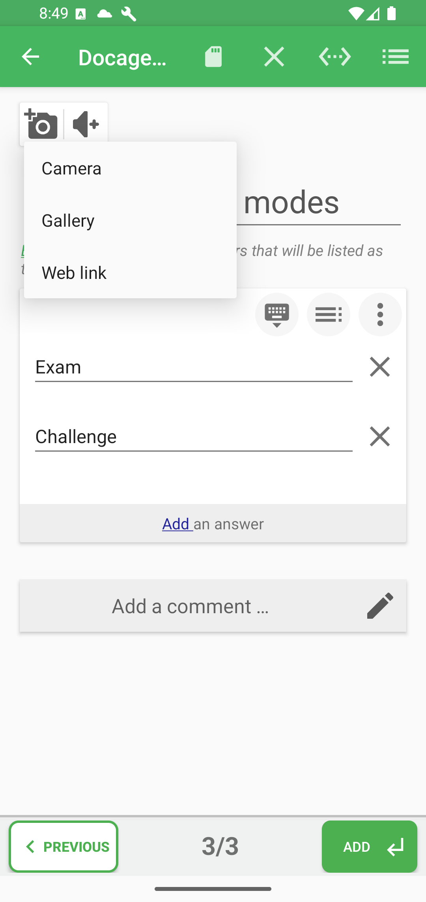
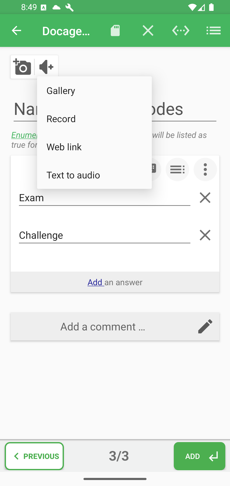
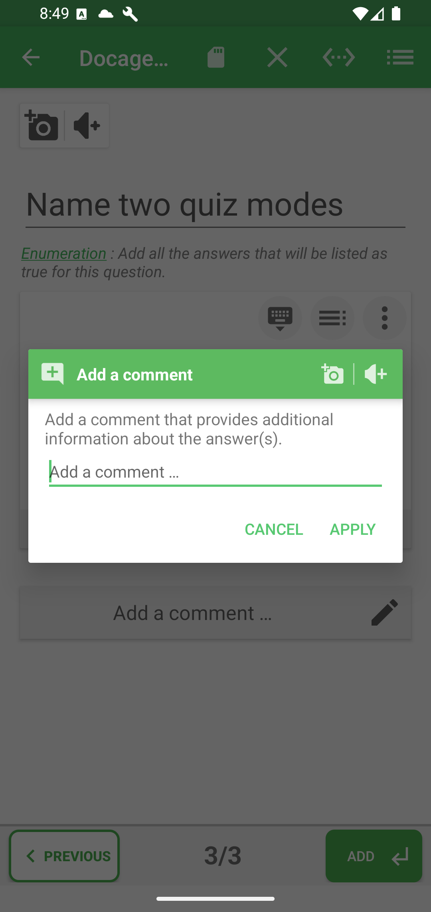

# Pictures, audio, and correction comments

Media can belong to the question, to an individual answer when the type supports it, or to the correction comment. Attach it at the level where it helps the learner understand the content.

## Add a picture to the question

Tap the camera button above the question. You can take a picture, choose one from the device, use a web link, or remove the current image. When an image is already attached, layout or crop actions may also appear.

Use a question picture when every answer refers to the same visual.

## Add audio to the question

Tap the audio button to choose a file, record sound, use a web link, or create audio from text. After attachment, use the player to listen and reopen its actions.

Use question audio for pronunciation, listening comprehension, a spoken prompt, or an accessibility alternative.

## Add media to one answer

Open the options area at the left of the answer row, then choose its picture or audio submenu. These commands are hidden for question types that expect only typed text.

In Match columns, each cell owns its own media even though the two cells form one pair.

## Turn text into audio

Open the audio menu for the question, a compatible answer, or a comment and choose the text-to-speech action. Enter the words to speak, check the available voice or language settings, and listen to the result before attaching it. Confirm the audio dialog, then save the quiz. This produces an audio resource; it does not replace the written question or answer.

## Change a picture's layout

Attach a picture first, then reopen that picture's actions and choose the layout action when available. Select the placement or display option offered for that image, confirm it, and preview the question to check how the picture fits beside the text. Available choices depend on the image's location and question type. Cropping changes the visible image area; layout changes how it is presented.

## Add a correction explanation

Tap **Add a comment**, or the pencil on an existing comment. A correction comment can combine:

- explanatory text;
- one picture;
- audio.

Use it to explain why an answer is correct, clarify a common mistake, or point learners toward what to review. Tap **Apply** to keep the dialog changes, then save the quiz from the main editor.

The comment dialog also supports **text formatting**: select words inside its text field and choose **Format** to use bold, italic, underline, colors, or highlights. These tools are also available directly in answer-proposal text fields. See [style answer proposals and correction comments](text-style/README.md) for the illustrated steps.

**Previous:** [Question and answer options](answer-options.md)

**Next:** [Organize, validate, and save](organize-and-save.md)
