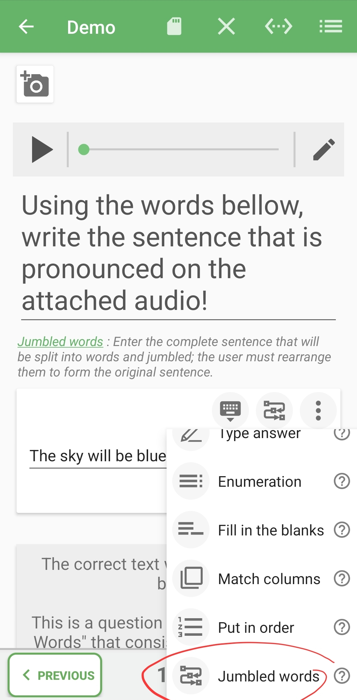
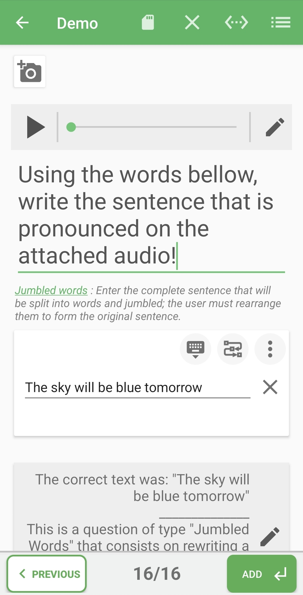

# Mots mélangés

Utilisez ce type lorsque le participant doit reconstruire une phrase de référence à partir de mots ou de fragments significatifs.

## Comment y accéder

Ouvrez ou créez un quiz, choisissez **Modifier les questions**, touchez l'icône du type actuel au-dessus de la carte des réponses, puis sélectionnez **Mots mélangés / Jumbled words**.

## Dans l'éditeur

Saisissez les mots ou fragments dans le bon ordre de référence. Pendant le jeu, QcmMaker les présente pour réordonnancement.

Le panneau général indique qu'aucune option supplémentaire n'est disponible. Conservez un contenu textuel : une action média peut apparaître dans le menu de ligne, mais un média non pris en charge peut être refusé à la validation.

## Conseils

- Découpez la phrase en fragments faciles à manipuler.
- Évitez les mots identiques répétés lorsque leur position serait impossible à distinguer.
- Vérifiez la ponctuation et les majuscules de la phrase finale.
- Précisez si des contractions ou un autre ordre peuvent être acceptés.

## Validation

Complétez toute la phrase de référence avant d'avancer. Testez la question pour vérifier que l'ordre attendu est clair et réalisable.

**Précédent :** [Mise en ordre](put-in-order-fr.md)

**Suivant :** [Options de la question et des réponses](../answer-options-fr.md)
