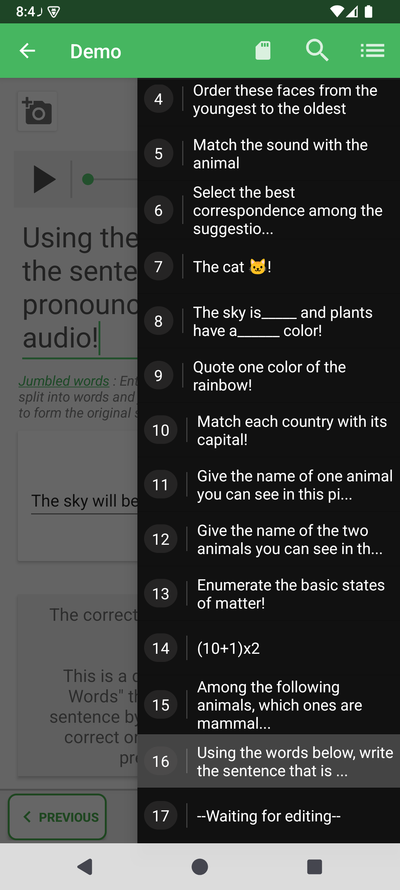
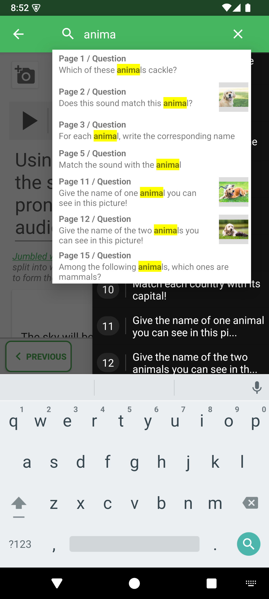

# Rechercher une question ou une réponse dans l'éditeur

La recherche dans un quiz ouvert permet de retrouver une question à partir de son énoncé, d'une proposition de réponse ou d'un commentaire de correction. Elle évite de parcourir toutes les questions d'un long quiz.

## Comment y accéder

Ouvrez un quiz → **Modifier les questions** → bouton de liste en haut à droite → **Rechercher**.

1. Ouvrez la liste des questions depuis la barre de l'éditeur.
2. Touchez la loupe dans la barre supérieure.
3. Saisissez un mot ou un fragment de phrase présent dans une question, une réponse ou un commentaire. La recherche ne distingue pas les majuscules des minuscules.

4. Touchez une suggestion correspondante pour ouvrir cette question dans l'éditeur.
5. Effectuez vos modifications, puis enregistrez le quiz.

Effacez la recherche ou fermez-la pour reprendre la navigation habituelle. En l'absence de résultat, essayez un fragment plus court et vérifiez que vous avez ouvert le bon quiz.

## Quels contenus sont recherchés ?

La recherche porte sur les énoncés, les textes des propositions et les commentaires de correction du quiz courant. Elle ne reconnaît pas les mots contenus dans une image ou un son. La recherche de l'accueil sert, elle, à retrouver des fichiers de quiz dans l'espace de travail.

- [Modifier les questions](../README-fr.md)
- [Naviguer et réordonner les questions](../organize-and-save-fr.md)

---

© QmakerTech — Dernière mise à jour : 2026-11-09
