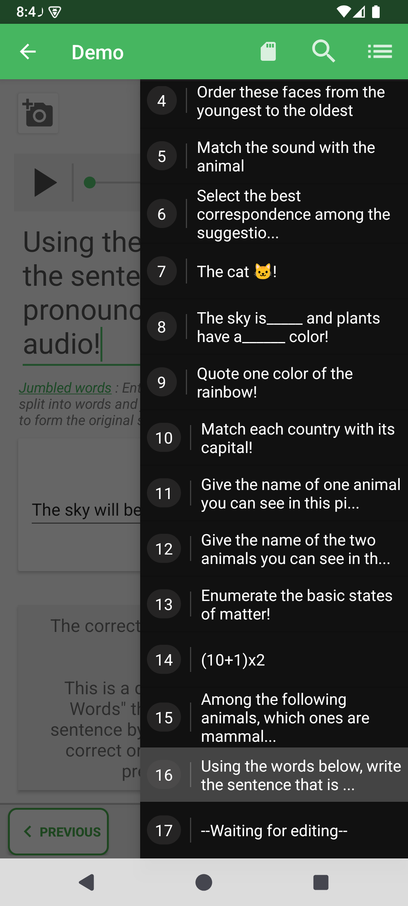
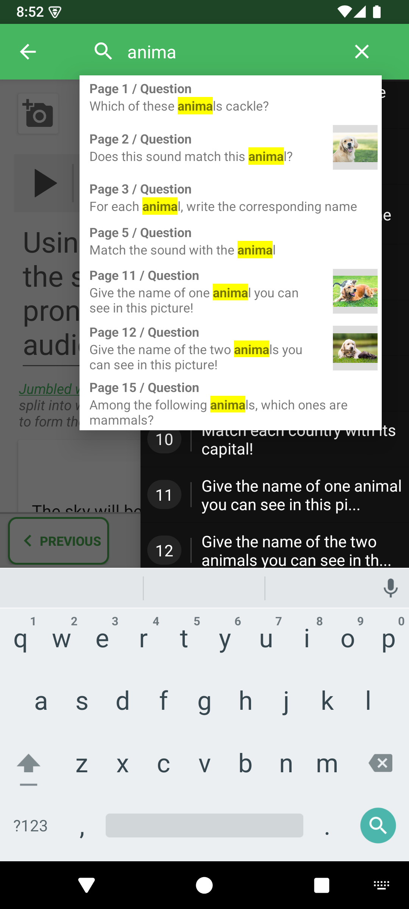

# Find a question or answer in the editor

Search inside an open quiz to find a question by its wording, an answer proposal, or a correction comment. This is useful for editing a long quiz without opening every question in turn.

## How to access

Open a quiz → **Edit questions** → question-list button at the top right → **Search**.

1. Open the question list from the editor toolbar.
2. Tap the magnifying glass in the toolbar.
3. Enter a word or part of a phrase from the question, an answer, or a comment. The search ignores letter case.

4. Tap a matching suggestion to open that question in the editor.
5. Make your changes and save the quiz.

Clear the query or close the search to return to ordinary navigation. If there is no match, try a shorter piece of text and check that you opened the correct quiz.

## What is searched?

The search covers the current quiz's question labels, answer labels, and correction-comment text. It does not recognize words inside images or audio. Home-screen search is separate: it finds quiz files in the workspace.

- [Edit questions](../README.md)
- [Navigate and reorder questions](../organize-and-save.md)

---

© QmakerTech — Last updated: 2026-11-09
