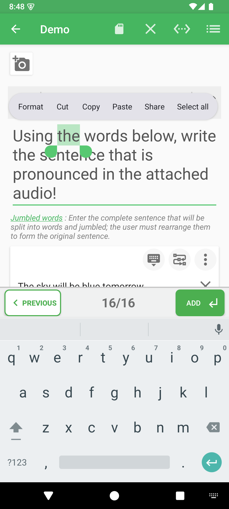
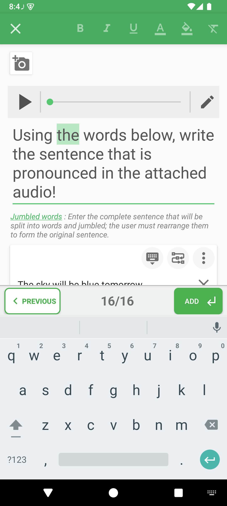
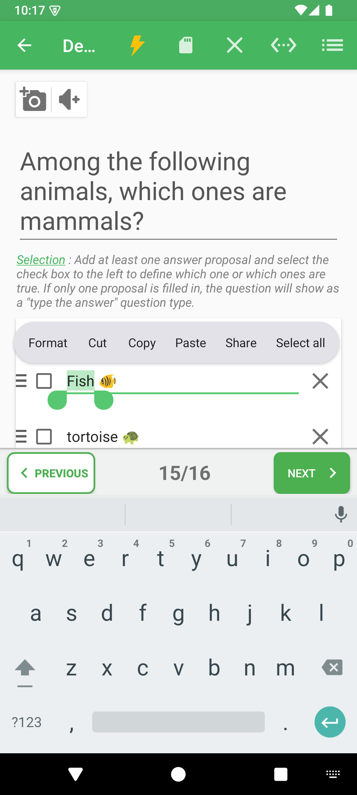
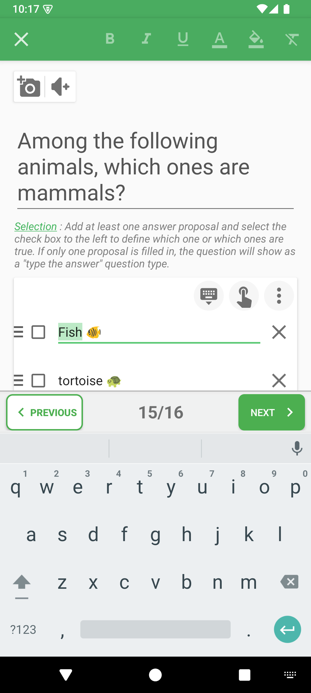
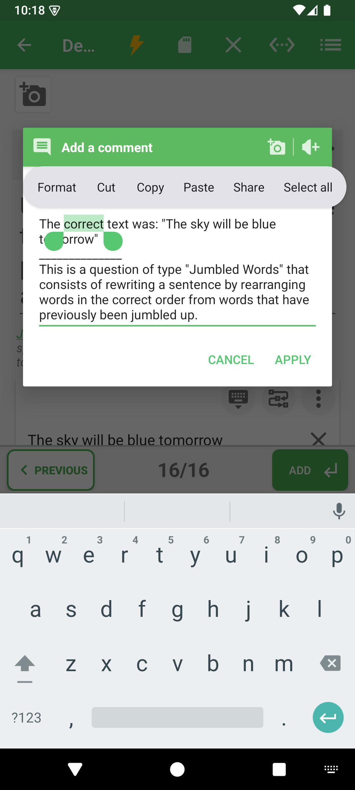
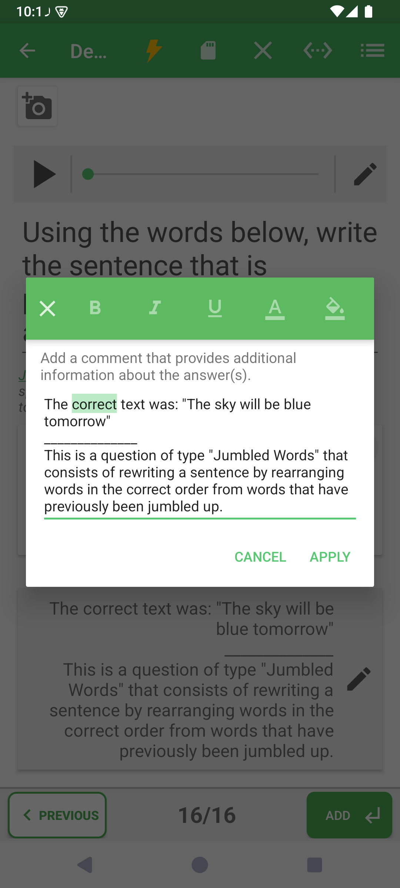

# Mettre en forme les textes du quiz

La mise en forme permet de faire ressortir un mot-clé, de distinguer une consigne ou de souligner un passage d'une explication. **Vous pouvez formater l'énoncé, chaque proposition de réponse et le texte à l'intérieur du dialogue d'édition du commentaire de correction.** Elle est également disponible dans les champs compatibles des informations du quiz.

## Comment y accéder

Ouvrez un quiz → **Modifier les questions** → appui long sur le texte à modifier → **Format**. Pour les informations du quiz, ouvrez **Modifier les informations**, puis le champ textuel souhaité.

| Texte à mettre en forme | Où le sélectionner |
|---|---|
| Énoncé de la question | Dans le grand champ supérieur de l'éditeur. |
| Proposition de réponse | Directement dans le champ textuel de cette réponse. Chaque proposition peut avoir ses propres styles. |
| Commentaire de correction | Ouvrez **Ajouter un commentaire**, ou le crayon d'un commentaire existant, puis sélectionnez le texte dans le dialogue. |
| Informations du quiz | Ouvrez le dialogue d'édition de l'information souhaitée et sélectionnez le texte d'un champ compatible. |

## Sélectionner le texte

1. Saisissez d'abord le texte.
2. Maintenez le doigt sur un mot, puis déplacez les poignées pour sélectionner le passage à modifier.
3. Touchez **Format** dans le menu de sélection. Si nécessaire, consultez les actions supplémentaires du menu.

## Appliquer un style

| Action | Effet sur la sélection |
|---|---|
| Gras | Renforce visuellement le texte. |
| Italique | Incline les caractères. |
| Souligné | Ajoute un trait sous le texte. |
| Couleur du texte | Ouvre un sélecteur de couleur pour les caractères. |
| Surlignage | Ouvre un sélecteur de couleur pour le fond du texte. |
| Effacer la mise en forme | Retire les styles du texte sélectionné. |

Touchez à nouveau une commande active de gras, d'italique ou de soulignement pour retirer ce style. Sur un petit écran, certaines commandes peuvent se trouver dans le menu supplémentaire de la barre.

Terminez avec la commande de retour ou de fin de la barre. Dans un dialogue de commentaire ou d'information, validez aussi ce dialogue, puis enregistrez le quiz. Prévisualisez ou lancez le quiz pour contrôler sa lisibilité, notamment les couleurs et le surlignage.

## Mettre en forme une proposition de réponse

  
  

1. Dans l'éditeur de questions, repérez la proposition à mettre en forme.
2. Faites un appui long sur un mot **dans le champ textuel de cette proposition**, puis ajustez les poignées de sélection.
3. Touchez **Format** et utilisez les mêmes commandes de gras, d'italique, de soulignement, de couleur, de surlignage ou d'effacement des styles que pour l'énoncé.
4. Fermez la barre de mise en forme, puis enregistrez le quiz.

Répétez l'opération pour les autres propositions si nécessaire : le style d'une réponse ne s'applique pas aux autres et ne change pas celles qui sont correctes.

## Mettre en forme le texte dans le dialogue de commentaire

  
  

1. Touchez **Ajouter un commentaire**, ou le crayon d'un commentaire de correction existant.
2. Saisissez ou sélectionnez l'explication **à l'intérieur du dialogue**, puis touchez **Format** dans le menu de sélection.
3. Appliquez les styles souhaités. La barre de mise en forme apparaît dans l'en-tête du dialogue lui-même.
4. Fermez la barre de mise en forme pour revenir au dialogue de commentaire.
5. Touchez **Appliquer** pour conserver le commentaire, puis enregistrez le quiz depuis l'éditeur principal.

Utilisez ces styles pour faire ressortir un mot-clé de correction, un raisonnement ou un point à réviser. Fermer la barre de mise en forme ne remplace pas la validation du dialogue et l'enregistrement du quiz.

## À savoir

Sélectionnez les mots souhaités avant d'appliquer un style. La mise en forme ne change pas les bonnes réponses. Une demande d'accès premium peut apparaître lorsque vous utilisez une commande de mise en forme ; suivez les options proposées par l'application.

- [Modifier les questions](../README-fr.md)
- [Ajouter des explications de correction](../media-and-comments-fr.md)

---

© QmakerTech — Dernière mise à jour : 2026-11-09
