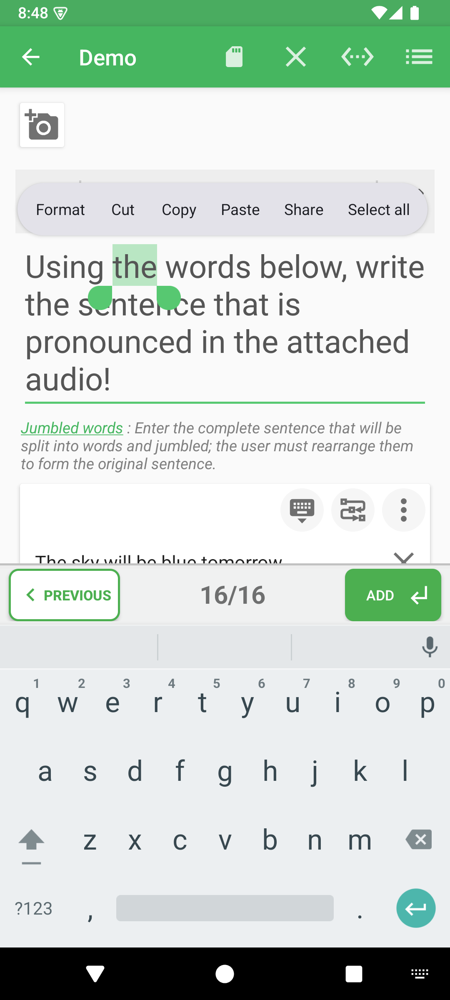
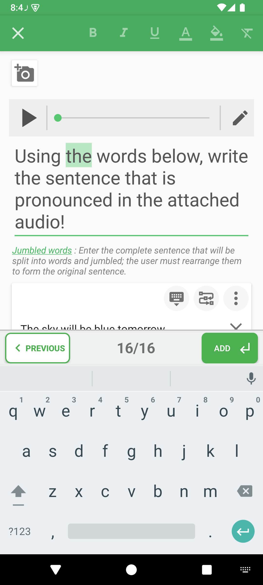

# Style quiz text

Use text formatting to emphasize a keyword, distinguish an instruction, or highlight an important part of an explanation. Formatting is available in supported text fields for questions, answer proposals, correction comments, and quiz information.

## How to access

Open a quiz → **Edit questions** → long-press the text you want to format → **Format**. For quiz information, open **Edit information**, then edit the desired text field.

## Select text and open formatting

1. Enter the text first.
2. Long-press a word and move the selection handles to cover the text you want to change.
3. Tap **Format** in the text selection menu. If the menu is crowded, check its additional actions.

## Apply a style

| Action | Effect on the selection |
|---|---|
| Bold | Emphasizes the text with a heavier weight. |
| Italic | Slants the text. |
| Underline | Draws a line beneath the text. |
| Text color | Opens a color picker for the letters. |
| Highlight | Opens a color picker for the text background. |
| Clear formatting | Removes formatting from the selected text. |

Tap an active bold, italic, or underline action again to remove that style. Some actions may appear in the toolbar overflow menu on smaller screens.

Finish with the toolbar back/done control. In a comment or information dialog, confirm that dialog too, then save the quiz. Preview or play it to check readability, especially when using text and highlight colors.

## Notes

Select the intended words before applying a style. Formatting does not change which answers are correct. A premium access prompt may appear when you request a formatting action; follow the access options shown by the app.

- [Edit questions](../README.md)
- [Add correction explanations](../media-and-comments.md)

---

© QmakerTech — Last updated: 2026-11-09
