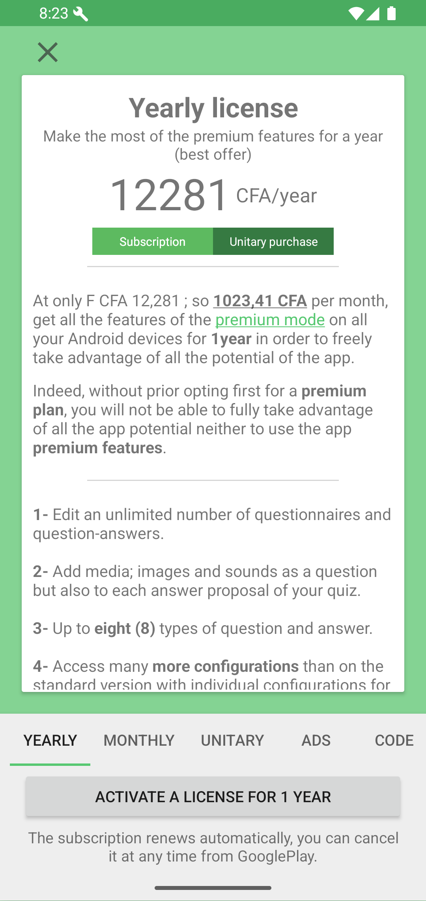
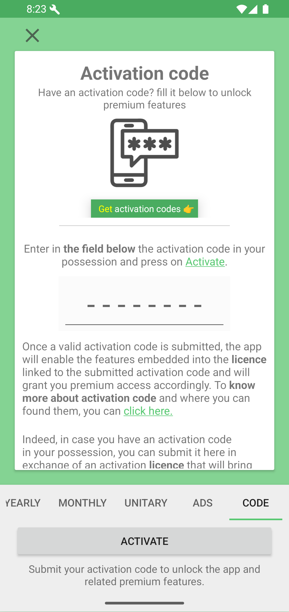
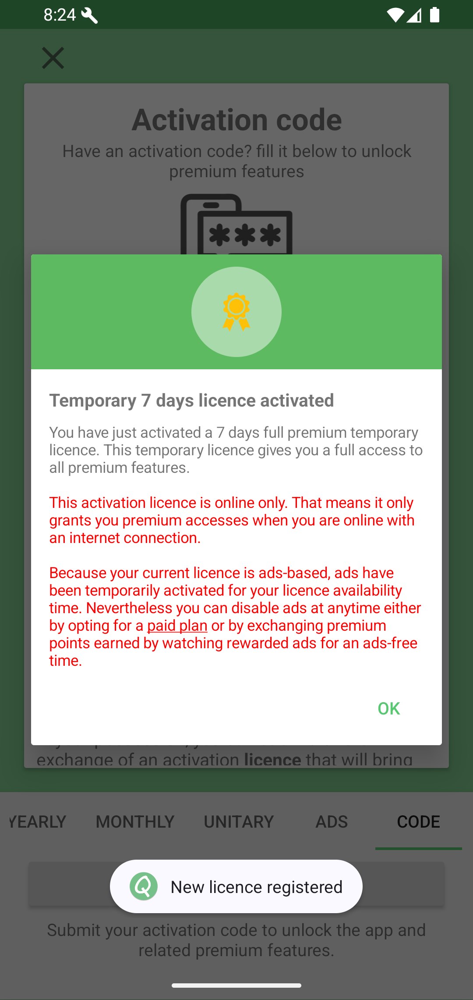
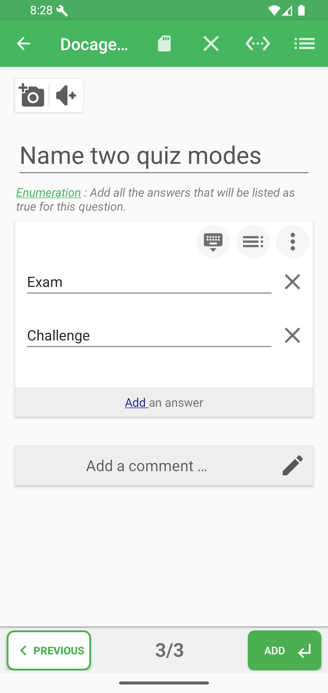

# Premium Features

Some advanced tools, such as advanced question types, can require premium access.

When access is needed, QcmMaker can offer a feature purchase, a trial, or the premium plans page.

Good to know: premium access controls advanced capabilities. It does not delete your existing `.qcm` files or take ownership of quizzes already saved in your workspace.

## How to access

Open the premium plans area offered by the app, or use the access prompt displayed when you request a restricted feature. In the per-feature purchase list, tap a product to read its details. Its guide link explains how to use it; opening the guide does not make a purchase.

## Learn how to use each feature

| Feature | Usage guide |
|---|---|
| Editor access | [Create and edit questions](../editor/README.md) |
| Unlimited questions and answers | [Add questions and answer rows](../editor/README.md) |
| Text styling | [Bold, italic, underline, colors, and highlights](../editor/text-style/README.md) |
| Question and answer search | [Search inside the open quiz](../editor/search/README.md) |
| Question duplication | [Duplicate a question](../editor/organize-and-save.md) |
| Question and answer reordering | [Move questions and answers](../editor/organize-and-save.md) |
| Typed answers | [Author accepted text answers](../editor/question-types/typed-answer.md) |
| Enumeration | [Author expected items](../editor/question-types/enumeration.md) |
| Fill in the blanks | [Author blanks and their answers](../editor/question-types/fill-in-blanks.md) |
| Match columns | [Author matching pairs](../editor/question-types/match-columns.md) |
| Put in order | [Author the correct sequence](../editor/question-types/put-in-order.md) |
| Jumbled words | [Author a sentence to reconstruct](../editor/question-types/jumbled-words.md) |
| Pictures in answers and comments | [Attach a picture](../editor/media-and-comments.md) |
| Audio in answers and comments | [Attach audio](../editor/media-and-comments.md) |
| Speech synthesis | [Turn written text into audio](../editor/media-and-comments.md) |
| Picture layout | [Change an attached picture's presentation](../editor/media-and-comments.md) |
| Answer randomization | [Configure question-level answer options](../editor/answer-options.md) |
| Input help | [Configure input assistance](../editor/answer-options.md) |
| Answer clues | [Help the learner fill a blank](../editor/answer-options.md) |
| Case sensitivity | [Control uppercase and lowercase matching](../editor/answer-options.md) |
| Custom scoring | [Define points and penalties](../create-quiz/scoring-policy/README.md) |
| Background music | [Add a quiz soundtrack](../create-quiz/background-music/README.md) |
| Player customization | [Quiz & player settings](../settings/player/README.md) |
| Interface customization | [App customization settings](../settings/workspace-behaviour/README.md) |
| Smart retakes | [Replay all or selected questions](../play-modes/result-and-replay.md) |
| Bookmarks | [Save and review questions](../bookmarks/README.md) |

Feature availability and access options depend on the plan currently offered in the app. Check the product details before buying: purchasing one feature does not automatically unlock other features used by the same question.

## Plans

The plans page includes yearly, monthly, unitary, ads-based, and activation-code options.

When to use this: choose a plan when you want continued access to advanced features after a trial or when a specific locked feature asks for premium access. If you already purchased access, look for the restore option before buying again.

Trial access, when offered, is meant to let you evaluate premium tools before choosing a longer access option.

## Activation code

If you have an activation code, open the **Code** tab, enter the code, then tap **Activate**.

After successful activation, QcmMaker confirms the license duration and access type.

## Ads-based access

An ads-based license can unlock premium features while showing ads from time to time.

What to check if access stays locked: keep the device online, confirm you are using the same Google account for purchases, and use the restore or activation option shown in the premium area when available.

## Remove ads

When the **Remove ads** product is available, open its details from the per-feature purchase list and follow the purchase flow if you want that option. Read any confirmation shown before changing an existing plan. If you have already purchased it, use purchase restoration with the same Google account rather than purchasing again.

An ads-based access option and an ad-removal purchase have different purposes. Check the app's current offer to see which features and access conditions apply to you.

---

© QmakerTech — Last updated: 2026-11-09
